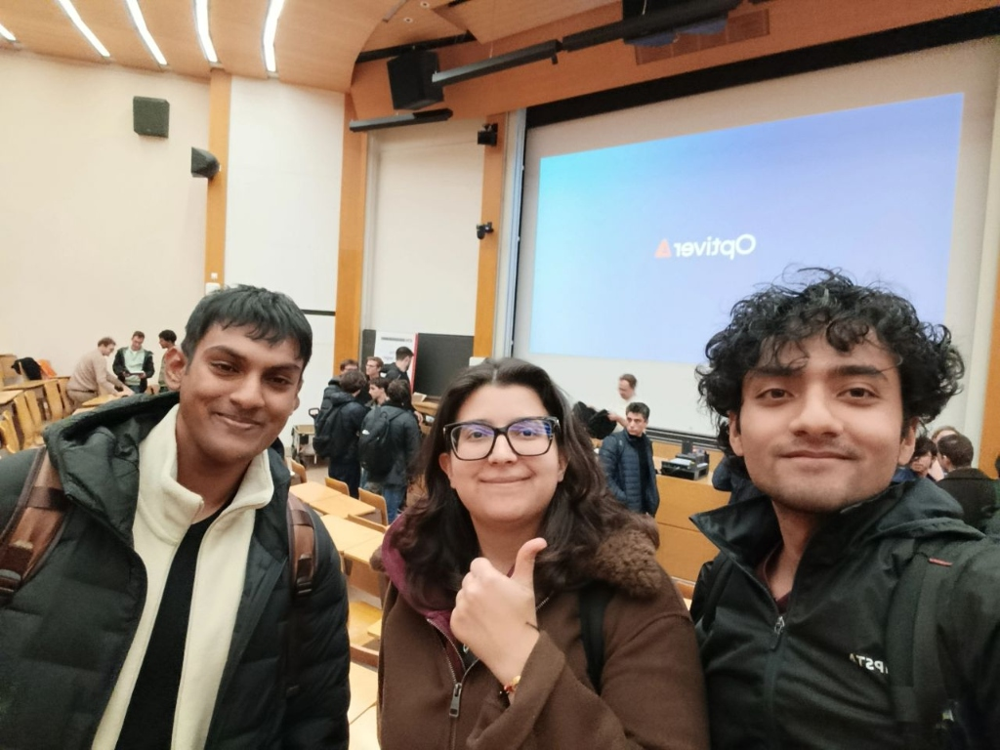
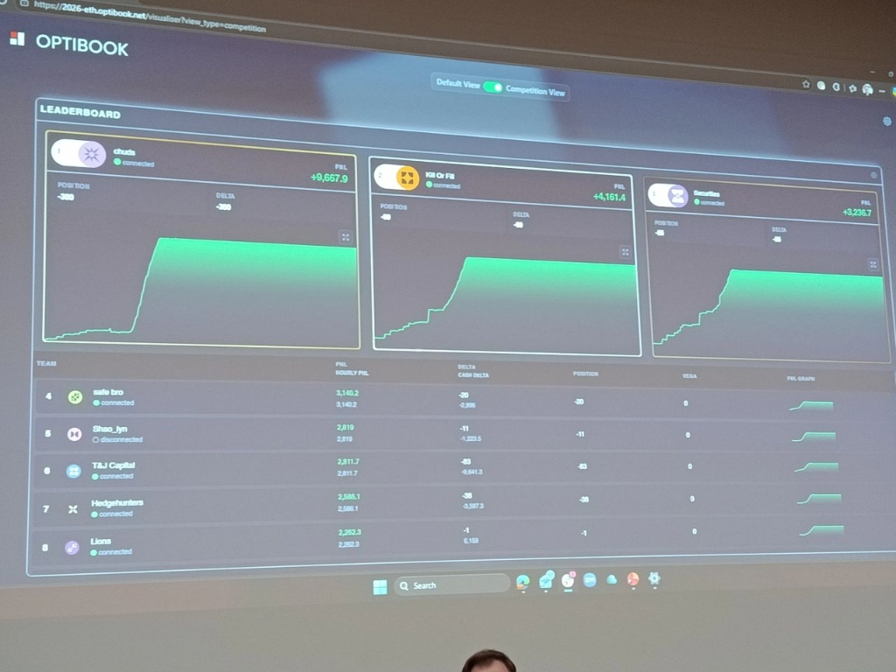
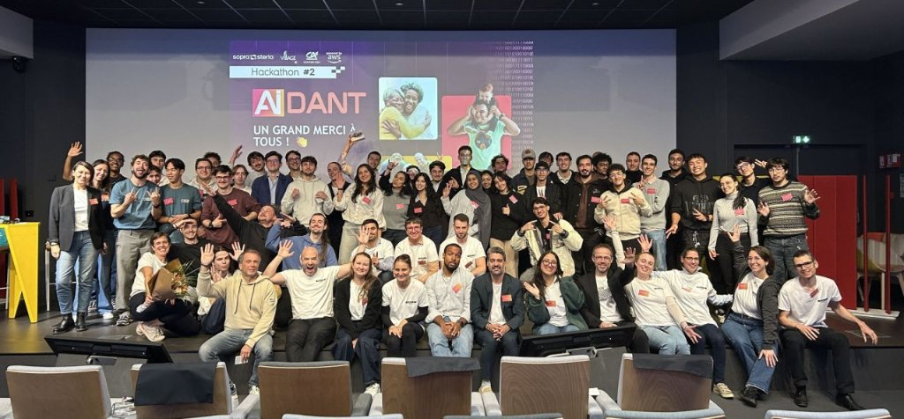

## Projects

### [Wasserstein Circuit-Breaker](https://github.com/housniCS/wasserstein-circuit-breaker)
**Distribution-Shift Resilience & Model Risk Control for Quantitative Trading**
- **Core Idea**: Real-time detection of Out-Of-Distribution (OOD) market regimes using rolling 1D Wasserstein distance ($W_1$) and Garman-Klass volatility on BTC/USDT 1h.
- **Model Risk Layer**: Interpretable surrogate decision tree (CART) trained on directional error residuals from Amazon Chronos-Bolt to isolate regime failure boundaries.
- **Capital Preservation**: Deterministic 100% Cash circuit-breaker filter, boosting directional accuracy to 56.5% in active regimes while neutralizing crash regimes.
- **Engineering**: Vectorized net-of-fees backtest engine (10 bps frictions), modular Python package (src/), and multi-panel visual analytics.
- 🔗 [Explore Code & Documentation on GitHub →](https://github.com/housniCS/wasserstein-circuit-breaker)

---

## Competitions & Hackathons

### **Optiver Trading & Coding Competition** - *ETH Zürich & ETH Entrepreneur Club*
**🥉 3rd Place out of 32 teams** *(Representing Polytech Lyon & Université Claude Bernard Lyon 1)*
- **Core Challenge**: Real-time programmatic market making and order book strategy execution on Optiver's simulated exchange platform (**Optibook**).
- **Execution & Strategy**: Built automated trading bots managing liquidity provision, spread capture, and delta/inventory risk under live, fast-moving market conditions.
- **Team**: Executed on the spot with teammates Asif Chowdhury and Ines Dimitrova.
- 

📸 View Podium Photos & Optibook Leaderboard

   
  
    
  
  

---

### **Sopra Steria x AWS GenAI Hackathon** - *Le Village by CA Centre-est*
**48h AI Hackathon for Caregiver Empowerment (*Aidants*)** *(Representing Polytech Lyon)*
- **Product & Impact**: Designed and prototyped a human-centric digital solution aimed at relieving the daily mental and logistical load of family caregivers.
- **Tech Stack & Engineering**: Built rapid generative AI workflows powered by **Amazon Bedrock (AWS)** foundation models, combining prompt design, model evaluation, and full-stack integration.
- **Team**: Collaborated alongside teammates Victor Lefevre and Cedric Momprive.
- 

📸 View Event Photo

   
  
  

---

## Education

### **M.Sc. in Artificial Intelligence (M2 IA)** - Claude Bernard Lyon 1 University *(2026 - 2027)*
> **Jointly accredited degree with:**
> - Université Jean Monnet Saint-Étienne
> - École Centrale de Lyon
> - École Nationale Supérieure des Mines de Saint-Étienne

### **Polytech Lyon** - Computer Science *(2024 - 2027)*
- Engineering Degree in Computer Science
- **Key Coursework & Topics:**
  - **Machine Learning & AI:** Deep Learning, Reinforcement Learning, Q-Learning, Deep Reinforcement Learning, Decision Trees
  - **Operations Research & Optimization:** Linear Programming (Programmation linéaire), Metaheuristics (Métaheuristiques), Genetic Algorithms (Algorithmes génétiques)

---

## Contact & Links

- GitHub: [@housniCS](https://github.com/housniCS)